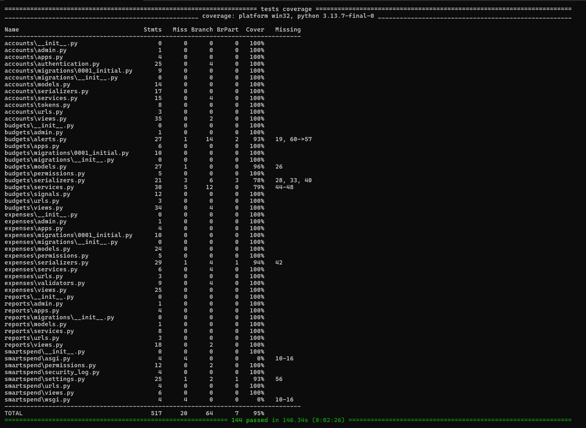
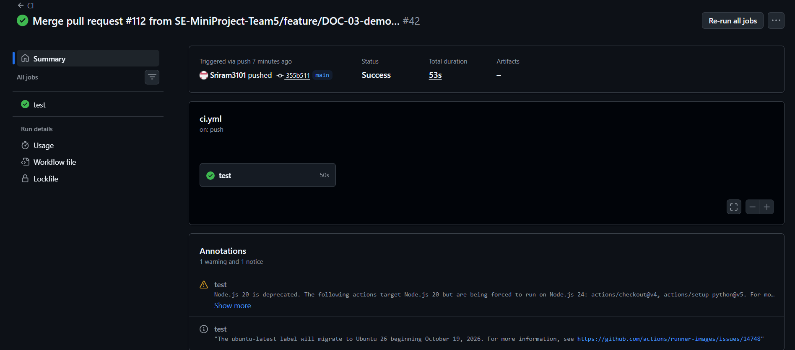

# SmartSpend: Smart Expense and Budget Manager

**SmartSpend** helps a user record expenses, organise them by category,
set weekly or monthly budgets, get alerts at 80% and 100% of a budget, and see where the money goes.
Administrators manage the master category list and see anonymised usage totals.

Version **v1.0** (end of Sprint 2, development frozen). Release notes: [docs/RELEASE_NOTES.md](docs/RELEASE_NOTES.md).

## Features

| Area | What it does | Requirements |
|---|---|---|
| Accounts | Register, log in, 24-hour Bearer token, own profile | FR-001 to FR-004, SEC-001, SEC-004, SEC-006 |
| Expenses | Add, edit, delete and list own expenses; custom categories | FR-005 to FR-008 |
| Budgets | Weekly or monthly budgets per category, no overlaps, live spent and remaining | FR-009 to FR-012 |
| Alerts | Alert at 80% and when the budget is exceeded; list and acknowledge | FR-013 to FR-015 |
| Reports | Spend by category, daily or weekly trend, CSV export | FR-016 to FR-018 |
| Admin | Manage master categories, anonymised usage totals, admin-only access | FR-019 to FR-021, SEC-002 |
| Security | Input sanitisation, security event log, no secrets in responses | SEC-003, SEC-005, SEC-006 |

## Technology stack

- Python 3.12, Django 5, Django REST Framework
- SQLite for local runs and CI; PostgreSQL through Docker Compose
- pytest, pytest-django, pytest-cov
- GitHub Actions for CI, GitHub Projects for the backlog and sprints

## Setup and run (Windows, Command Prompt)

```bat
git clone https://github.com/SE-MiniProject-Team5/MiniProject_Team5_Smart_Budget_Manager.git
cd MiniProject_Team5_Smart_Budget_Manager
py -3.12 -m venv .venv
.venv\Scripts\activate
pip install -r requirements.txt
python manage.py migrate
python manage.py runserver
```

On macOS or Linux, use `python3.12 -m venv .venv` and `source .venv/bin/activate` instead.

Open http://127.0.0.1:8000/ for the home page and http://127.0.0.1:8000/api/v1/health/ for a health check.

To make an account an administrator (after registering it):

```bat
python manage.py shell -c "from accounts.models import User; User.objects.filter(email='you@example.com').update(role='ADMIN')"
```

## API

All endpoints are under `/api/v1/` and use JSON. Every endpoint except register, login and health needs the header
`Authorization: Bearer <token>`, where the token comes from login.

| Method | Endpoint | Purpose | Access |
|---|---|---|---|
| POST | `/api/v1/auth/register/` | Create an account | Anyone |
| POST | `/api/v1/auth/login/` | Log in, get a token | Anyone |
| GET | `/api/v1/auth/me/` | Own profile (id, email, role) | User |
| GET, POST | `/api/v1/categories/` | List categories, add a custom one | User |
| GET, POST | `/api/v1/expenses/` | List own expenses, add one | User |
| GET, PUT, PATCH, DELETE | `/api/v1/expenses/<id>/` | One own expense | Owner |
| GET, POST | `/api/v1/budgets/` | List own budgets, add one | User |
| GET, PUT, PATCH, DELETE | `/api/v1/budgets/<id>/` | One own budget, with spent and remaining | Owner |
| GET | `/api/v1/alerts/` | Own active alerts, newest first | User |
| POST | `/api/v1/alerts/<id>/acknowledge/` | Mark an alert as seen | Owner |
| GET | `/api/v1/analytics/?from=&to=` | Spend by category | User |
| GET | `/api/v1/analytics/trend/?from=&to=&granularity=daily\|weekly` | Spend per day or week | User |
| GET | `/api/v1/reports/export/?from=&to=` | CSV file of expenses | User |
| GET, POST | `/api/v1/admin/categories/` | List or add master categories | Admin |
| GET, PUT, PATCH | `/api/v1/admin/categories/<id>/` | Rename or disable a master category | Admin |
| GET | `/api/v1/admin/analytics/` | Anonymised usage totals | Admin |
| GET | `/api/v1/health/` | Health check | Anyone |

Dates are written as `YYYY-MM-DD`. Amounts are decimals with two places, for example `"250.00"`.

## Tests and coverage

```bat
pytest
```

This runs every test and prints a coverage table. The coverage report for each module is saved in
[docs/coverage/](docs/coverage/). Each module is above the 70% target.



Test Plan results (Actual Result and Pass/Fail for all 13 test cases): [docs/TEST_RESULTS.md](docs/TEST_RESULTS.md).

## Performance (NFR-001)

With the server running, in a second Command Prompt:

```bat
python scripts\load_test.py
```

It sends 50 concurrent users x 10 requests to the dashboard endpoint and checks that 95% finish within 2 seconds.
Recorded result: [docs/perf/nfr001_results.txt](docs/perf/nfr001_results.txt).

## Continuous integration

GitHub Actions runs on every pull request and every push to `main` (`.github/workflows/`): it installs the
requirements, runs `python manage.py check`, checks no migration is missing, and runs `pytest`. `main` is protected,
so changes reach it only through pull requests, and each pull request is reviewed and merged by another member.



## Demo

With the server running: `python docs/demo/sprint1_demo.py` (Sprint 1 features) and
`python docs/demo/sprint2_demo.py` (Sprint 2 features). The recorded videos are in [docs/demo/](docs/demo/).

## Docker

```bash
docker compose up --build
```

This starts the app with PostgreSQL. Copy `.env.example` to `.env` and set the values first.

## Documents

| Document | File |
|---|---|
| Software Requirements Specification | [SRS_H5.pdf](SRS_H5.pdf) |
| Architecture and Design Specification | [SW_Architecture_Design_Spec_H5.pdf](SW_Architecture_Design_Spec_H5.pdf) |
| Test Plan | [Test_Plan_H5.pdf](Test_Plan_H5.pdf) |
| Test results | [docs/TEST_RESULTS.md](docs/TEST_RESULTS.md) |
| RTM code references | [docs/RTM.md](docs/RTM.md) |
| Design updates (SAD/SRS) | [docs/DESIGN_UPDATES.md](docs/DESIGN_UPDATES.md) |
| Deviation log | [DEVIATIONS.md](DEVIATIONS.md) |
| Release notes | [docs/RELEASE_NOTES.md](docs/RELEASE_NOTES.md) |

## Project structure

```text
accounts/    registration, login, tokens, profile (Auth Service)
expenses/    expenses, categories, input sanitiser (Expense Service)
budgets/     budgets, Alert Engine, alerts (Budget Service, Alert Engine)
reports/     analytics, trend, CSV export, admin categories and analytics (Report Service, Admin API)
smartspend/  settings, URLs, admin permission, security log
templates/   Django templates for the UI
tests/       pytest tests
scripts/     load test
docs/        test results, RTM, design updates, coverage, performance results, screenshots, demos
```

## Team and ownership

| Member | GitHub | Owns |
|---|---|---|
| M1 | sriram211106 | Accounts and authentication |
| M2 | Sriram3101 | Expenses and categories |
| M3 | srijan-nanda | Budgets and alerts |
| M4 | Pranav-146 | Reports, analytics and admin |

## Workflow

Each backlog item is a GitHub issue on the project board. Work is done on a feature branch, opened as a pull request
with `Closes #<issue>`, checked by CI, reviewed and merged by another member (M1's PRs by M2, M2's by M3, M3's by M4,
M4's by M1).
